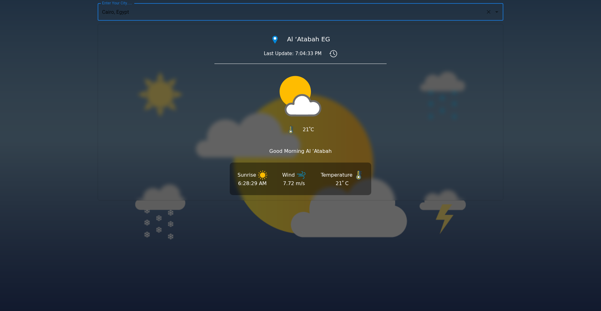

# Weather App

A React weather app. Search for a city and see its current weather.

**Live demo:** https://weather-status-beta.vercel.app



## Features

- Search any city with autocomplete suggestions (Geoapify)
- Current temperature, conditions and details (OpenWeather)
- Responsive layout for mobile and desktop

## Tech

- React 18 (Create React App)
- Material UI and React Bootstrap
- SCSS
- Geoapify and OpenWeather APIs

## How to run

1. Clone the repo and install dependencies:

   ```bash
   npm install
   ```

2. Copy `.env.example` to `.env` and add your own API keys:

   ```
   REACT_APP_GEOAPIFY_KEY=your_geoapify_key
   REACT_APP_OPENWEATHER_KEY=your_openweather_key
   ```

3. Start the dev server:

   ```bash
   npm start
   ```

Open http://localhost:3000.

Note: Create React App inlines these keys into the browser bundle, so they are visible to anyone using the site. Use free, low-limit keys.

